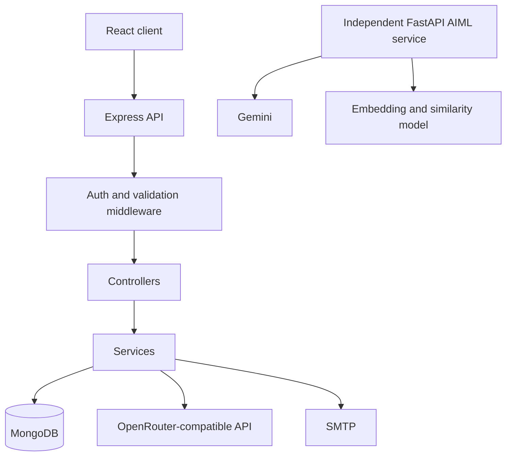

# Architecture

## Components

1. **React client** — routing, layouts, UI state, demo presentation data, and selected API calls.
2. **Express server** — persistent application API, authentication, authorization, validation, moderation, mail, and server-side assistant.
3. **MongoDB** — users, challenges, revoked tokens, posts, reports, listings, announcements, and locations.
4. **AIML service** — separate FastAPI process for Gemini question answering and semantic matching.
5. **External providers** — SMTP for OTP mail and OpenRouter-compatible API for the Express assistant.

The AIML service is independently runnable. The current React assistant path calls Express `/api/assistant/chat`; it does not automatically proxy through FastAPI.

## Request flow

The browser calls the Express API at `VITE_API_URL`. Express validates input, checks the session cookie and role, executes a controller, and returns the shared API response shape. Mongoose persists domain data.

## Frontend layers

`AppRoutes` composes public, protected, and admin layouts. Context providers expose auth, toast, and modal state. Pages use reusable layout, card, feedback, and loading components. Most content pages currently use local arrays in `Pages.jsx`.

## Backend layers

Routes define paths and middleware. Controllers coordinate models and services. Models define persistence and indexes. Services isolate mail, assistant-provider calls, and bootstrap behavior. Centralized middleware handles validation, auth, not-found, and errors.

## Trust boundaries

Client route guards and local demo sessions are presentation concerns. Only server-side authentication and role checks provide authorization. Provider keys and database credentials belong only in server/AIML environments.

## Authentication and email flow

Registration stores a temporary challenge with hashed OTP and registration token values, sends the OTP through Nodemailer, and creates a user only after verification. Login signs a JWT with a unique `jti`; the HTTP-only cookie is checked by `requireAuth`, and logout records the `jti` in the revoked-token collection.

## Campus map

The server has a searchable `CampusLocation` model and `GET /api/campus/locations`. The current client map page is still a local/demo presentation and does not render a fully integrated map provider.
