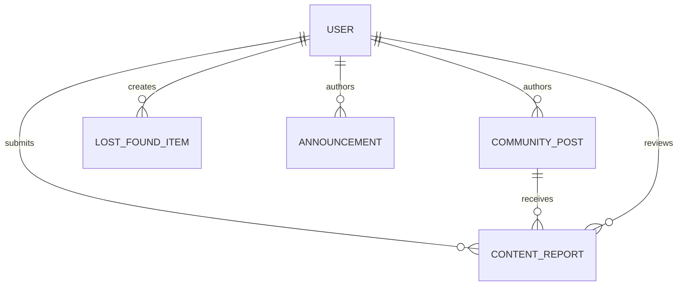

# Database schema

MongoDB is used through Mongoose. The server defines these collections:

| Model | Purpose | Important fields |
|---|---|---|
| `User` | Identity and account state | name, email, student ID, department, role, status, verification, reputation |
| `RegistrationChallenge` | Temporary registration state | email, student ID, password hash, OTP hash, registration token hash, expiry, attempts |
| `RevokedToken` | Session invalidation | token identifier and TTL expiry |
| `CommunityPost` | Community content | author, alias, title/body, category, likes, moderation state |
| `ContentReport` | Moderation queue | reporter, content reference, reason, review status |
| `LostFoundItem` | Lost or found listing | title, category, location, status, description, creator |
| `Announcement` | Campus updates | author, title/body, category, department, status, urgent, pinned, publish time |
| `CampusLocation` | Searchable places | name, description, coordinates, active state |

Indexes and validation are defined in the individual model files. List endpoints use pagination helpers and model-level filters.

## Field details

| Model | Fields and constraints |
|---|---|
| `User` | `name` string required 2–100; `emailId` string required, unique, lowercase, max 254; `collegeId` string required, unique, max 64; `passwordHash` string required and excluded by default; `department` required string; optional `year` 1–6, `section` max 20, `avatar`; `bio` max 250; `role` enum `student`, `faculty`, `publisher`, `moderator`, `admin`; `status` enum `active`, `inactive`, `suspended`, `banned`; `verified` default true; dates, `reputation` default 0 and non-negative. |
| `RegistrationChallenge` | `emailId`, `collegeId`, `name`, `department`, `passwordHash`, `otpHash`, and `registrationTokenHash` required; `expiresAt` required TTL; `lastOtpSentAt` defaults now; `attempts` defaults 0 and is capped at 5. |
| `RevokedToken` | Required unique `jti` and required TTL `expiresAt`. |
| `CommunityPost` | Required `author` User reference, `alias` max 40, `title` max 120, `body` max 2000; `category` enum `Academics`/`Campus life`; `likedBy` User references; `status` enum `active`/`removed`, default `active`. |
| `ContentReport` | Required `reporter` User reference, `post` CommunityPost reference, and `reason` max 500; `status` enum `pending`/`reviewed`/`dismissed`; nullable reviewer and review date. |
| `LostFoundItem` | Required `creator` User reference, `title` 2–120, `category` 2–80, `location` 2–160, `description` 2–2000, and `status` enum `Lost`/`Found`. |
| `Announcement` | Required `author` User reference, `title` 2–180, `category` max 80, `department` max 100; `body` default empty max 5000; `urgent`/`pinned` default false; `status` enum `draft`/`published`/`archived`, default `published`; `publishAt` defaults now. |
| `CampusLocation` | Required unique `name` 2–120; `description` default `Campus location` max 500; optional bounded latitude/longitude; `address` default empty max 240; `active` default true. |

All schemas except `RevokedToken` use Mongoose timestamps. Text and compound indexes are declared in the model files: user role/status/department indexes; post author/status/category/createdAt/text indexes; lost-found creator/category/location/status/createdAt/text indexes; announcement category/department/status/publishAt/compound/text indexes; report reporter/post/status/createdAt indexes; location active/text index; and TTL/uniqueness indexes for temporary security records.

## Relationships

- Posts, announcements, and reports reference users.
- Reports reference moderated content.
- Revoked tokens are associated with JWT identifiers rather than storing usable passwords or tokens.
- Registration challenges are temporary and expire after the OTP window.

There are no migration files in this repository; schema changes are applied through Mongoose model behavior and operational database management.

